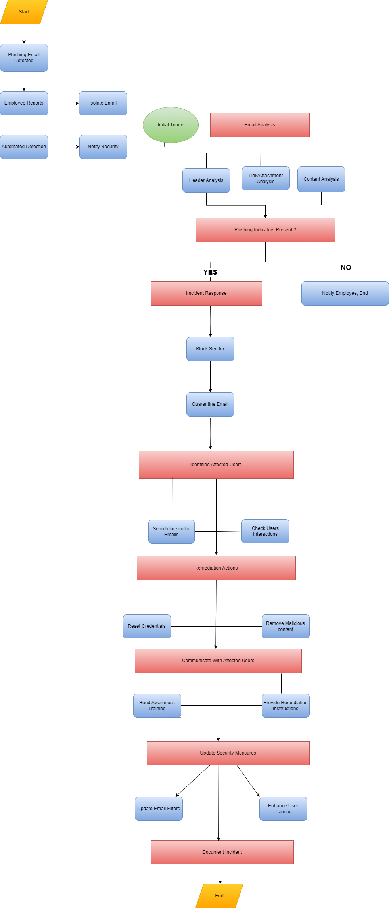

# 🎣 Phishing Incident Response Playbook

I wrote this playbook as an **Information Security Analyst at a credit union** to standardize how the security team detects, investigates, contains, and learns from phishing attacks. It pairs with the phishing simulations and security awareness training I ran to strengthen employee reporting and internal defenses.

## 📋 What's Inside

1. **Understanding Phishing:** what phishing is and how attackers impersonate trusted entities
2. **Phishing Attack Lifecycle:** the stages of a phishing attack
3. **Detection & Prevention:** technical controls and employee reporting
4. **Response & Mitigation:** incident response plan, communication strategy, and recovery steps
5. **Phishing Simulation & Training:** running simulated campaigns and measuring effectiveness
6. **Response Flowchart:** a visual, step-by-step decision workflow (below)

## 🔀 Response Workflow

| # | Phase | Key Actions |
|---|---|---|
| 1 | **Detection** | Employee report, or automated detection by the email security gateway |
| 2 | **Initial Triage** | Isolate/quarantine the email and notify the security team |
| 3 | **Email Analysis** | Header analysis (spoofing, sender reputation), link/attachment analysis, content analysis (urgency, credential requests) |
| 4 | **Decision** | Phishing indicators present? **No:** notify the employee and close. **Yes:** escalate to IR |
| 5 | **Containment** | Block the sender/domain and purge the message from all inboxes |
| 6 | **Scoping** | Search for similar emails and identify users who clicked or opened attachments |
| 7 | **Remediation** | Reset compromised credentials and remove malicious content from endpoints |
| 8 | **Communication** | Give affected users remediation instructions and targeted awareness training |
| 9 | **Hardening** | Tune email filters and update training with new tactics |
| 10 | **Lessons Learned** | Document the incident, actions taken, and improvements |

## 💡 Skills Demonstrated

- Incident response planning aligned to the **Preparation → Detection → Containment → Eradication → Recovery → Lessons Learned** lifecycle
- Email forensics (header, URL, and attachment analysis)
- Security awareness program design and phishing simulation
- Turning technical procedures into clear documentation for both analysts and leadership

## 📄 Full Playbook

📥 [`Phishing Play book for TCFU.pptx`](<Phishing Play book for TCFU.pptx>) (download to view the full slide deck)
